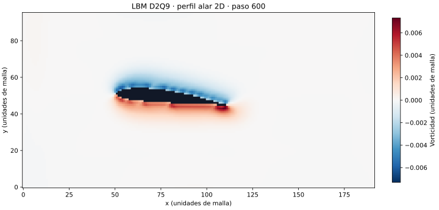

# LBM: simulación aerodinámica 2D en C++ y CUDA

[](https://github.com/cristo2401/LBM_CUDA_Aerodynamics_HPC/actions/workflows/cpu-smoke.yml)

Proyecto académico de simulación de fluidos mediante **Lattice Boltzmann D2Q9**.
Incluye un solver CPU en C++17, casos con obstáculos y perfiles alares, y un
benchmark CUDA que compara distribuciones de memoria AoS y SoA.

El objetivo es estudiar implementación numérica, exportación de campos y rendimiento
CPU/GPU. Los casos son bidimensionales y usan unidades de malla. No constituyen
validación para diseño aerodinámico de vehículos reales.

## Vista del simulador



Salida del solver CPU en una malla de 192 × 96 a 600 pasos. Es una ilustración de un
transitorio, no una solución convergida ni una medición física. El comando y el
script para regenerarla están en [la guía de la figura](docs/PREVIEW.md).

## Probar en CPU

Requisitos: Linux, Make, compilador C++17 (por ejemplo GCC) y Python 3 para revisar
las salidas. OpenMP se usa por defecto; no se necesita GPU ni instalar librerías Python.

```bash
git clone https://github.com/cristo2401/LBM_CUDA_Aerodynamics_HPC.git
cd LBM_CUDA_Aerodynamics_HPC
OMP_NUM_THREADS=2 make smoke vehicle-smoke
python3 scripts/check_smoke_outputs.py \
  resultados/smoke_test resultados/smoke_sports_car resultados/smoke_formula1
```

Esto compila y ejecuta tres casos cortos. La comprobación exige frames completos,
valores finitos, densidad positiva y diagnósticos hasta el último paso. CI repite
esos casos con y sin OpenMP. Estas pruebas detectan fallos de ejecución/exportación;
no prueban convergencia, conservación a largo plazo ni precisión de Cd/Cl.

Para compilar sin OpenMP en un directorio distinto:

```bash
make OPENMP=0 BUILD_DIR=ejecuciones/build-serial
```

También hay una configuración CMake:

```bash
cmake -S . -B ejecuciones/cmake-build
cmake --build ejecuciones/cmake-build -j2
```

## Casos y salidas

| Comando | Caso | Directorio generado |
|---|---|---|
| `make smoke` | Obstáculo circular, prueba corta | `resultados/smoke_test` |
| `make vehicle-smoke` | Dos contornos SDF, pruebas cortas | `resultados/smoke_sports_car`, `resultados/smoke_formula1` |
| `make airfoil` | Perfil NACA 2412 a 6° | `resultados/airfoil` |
| `make sports-car` | Contorno 2D de auto deportivo | `resultados/sports_car` |
| `make formula1` | Contorno 2D de Formula 1 | `resultados/formula1` |

Los tres últimos casos generan más frames y consumen más memoria/disco. Cada
ejecución exporta `metadata.json`, `frames/frame_*.bin`, `forces.csv` y
`diagnostics.csv`. Los campos float32 son `rho`, `ux`, `uy`, `pressure`,
`vorticity`, `solid` y `phi`; el índice es `x + nx * y`.
En Python, cada campo se reconstruye con `field.reshape(ny, nx)`.

El [notebook de visualización](notebooks/viewer.ipynb) permite explorar las salidas;
tiene dependencias Python adicionales a las pruebas CPU anteriores.

## Comparación CUDA

Requiere una GPU NVIDIA y CUDA Toolkit con `nvcc` compatible con C++17.

```bash
make gpu-benchmark
```

Compara `cpu_reference`, `gpu_aos_naive` y `gpu_soa_optimized`, y genera
`resultados/gpu_benchmark/gpu_kernel_timings.csv` y `gpu_kernel_comparison.json`.
Para usar la máscara del caso Formula 1, ejecuta `make formula1` y luego
`make gpu-benchmark-f1`.

El benchmark de kernels es un ejecutable separado del solver CPU que genera las
simulaciones. Su tiempo no representa necesariamente la aceleración de todo el
flujo, incluida la exportación y visualización. CI no ejecuta CUDA.

## Dónde leer el código

- [Solver CPU](librerias/src/lbm_solver.cpp): evolución de la simulación.
- [Kernels CUDA](librerias/cuda/): implementaciones AoS y SoA.
- [Benchmark](librerias/benchmarks/gpu_lbm_benchmark.cpp): comparación de kernels.
- [Geometrías](librerias/geometries/): contornos importados.
- `resultados/` y `ejecuciones/`: salidas y compilación locales, regenerables.

## Trabajo pendiente

- Validación con casos de referencia y estudios de convergencia espacial/temporal.
- Comparación numérica CPU/GPU por campo y tolerancias documentadas.
- Benchmarks repetidos con hardware, versiones y dispersión de tiempos registrados.
